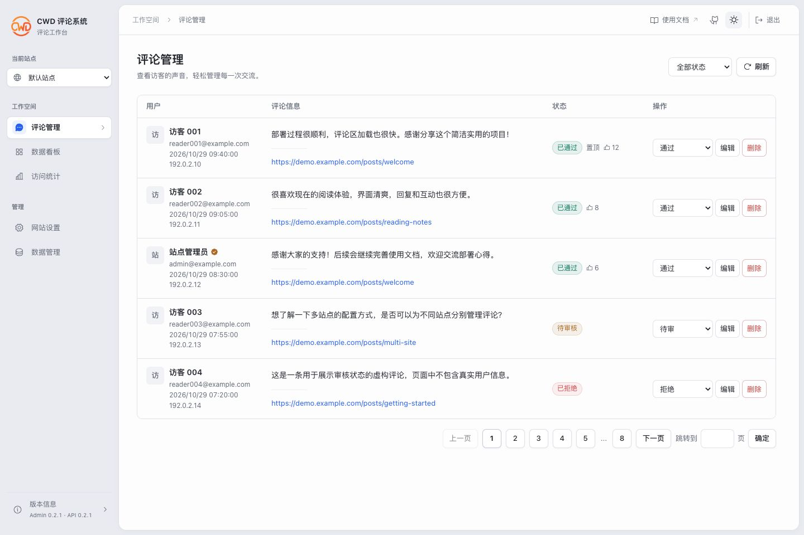
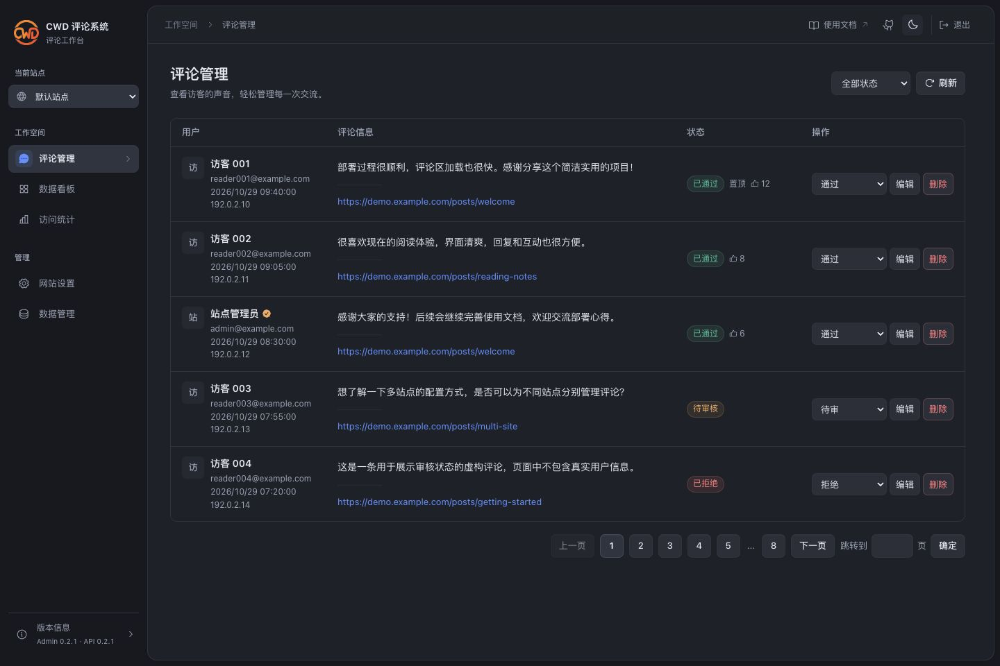
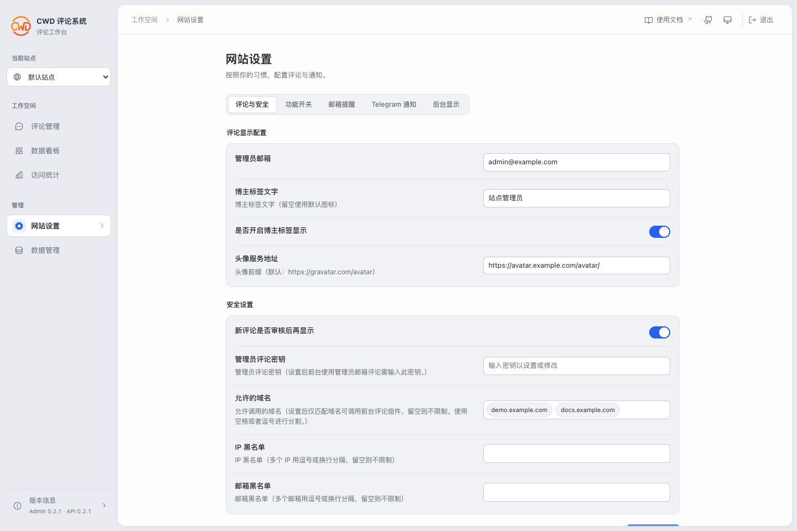

# CWD (Cloudflare Workers Discuss)

基于 Cloudflare Workers 与全球边缘网络的免服务器、极速安全、即插即用评论系统。

数据存储在 Cloudflare D1 数据库中，通过 Worker 与数据库交互。

[使用文档](https://cwd.js.org) · [社区交流](https://github.com/anghunk/cwd/discussions)

## Preview

**评论端**

**后台管理**

以下后台截图均使用虚构演示数据，邮箱、域名和 IP 均为示例值。

更多截图

**评论管理 · 深色模式**

**数据看板**

**网站设置**

## Thanks

感谢以下项目和人员的贡献：

- [Cloudflare Workers](https://workers.cloudflare.com/)
- [Cloudflare D1](https://www.cloudflare.com/products/database/)
- [Momo-Backend](https://github.com/Motues/Momo-Backend)

## LICENSE

开源协议：[Apache-2.0](./LICENSE)
